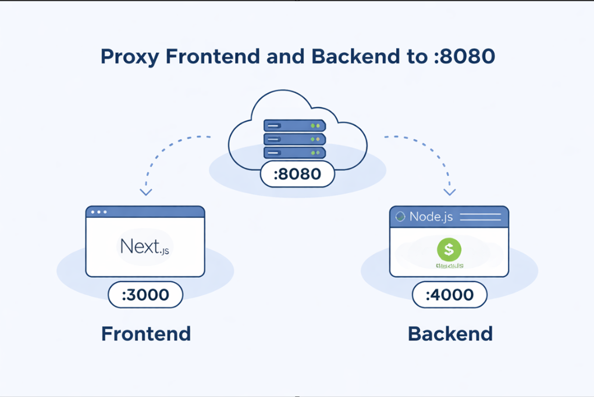

# iEARN Žiežmariai tinklapis Ⓒ 2026

Meant for the "iearn Žiežmariai" club.

Šis tinklapis nuvo sukurtas tinklalapių kūrimo mokinimosi tikslais, siekiant padaryti brandos darbą 11-12 klasėse (2022 m.). Taigi šis projektas turėjo gana daug drąstiškų, keistų, per daug komplikuotų sprendimų vien dėl to, nes tuo metu atrodė super duper kietai ir efektyvu - lyg ši svetainė turės tūkstančius vartotojų kiekvieną dieną...  
Taigi šią sveitainę per naują galimą padaryti naudojant per pus mažiau kodo ir kodas būtų daug labiau suprantamesnis, kadangi pagrindis šio projekto priešas yra - **GraphQL**. Buvo galima daryti paprastą REST api, tačiau ne - pasirinkau patį pirmą YT pasitaikusį tutoria su daugiausiai peržiūrų ir iš jo viską mokinausi. Tokių video paskirtis yra - surinkti kuo daugiau peržiūrų naudojant naujas ir įmantrias technologjas - kurios greitai gali pasenti (kaip graphql).

Taigi, kas norės pasileisti šį projektą - sėkmės!

## Technology stack

1. **Node.js** and a node global package, Yarn, installed in your environement.
2. **MySQL** database.
3. **Redis** for storing string based keyed data (cookies)
4. **Caddy proxy** server for combining the proccesses to one port
5. **Tailscale** to use its **_funnel_** feature to make the website accessable for free.

Caddy and Tailsale is a hack I put together to easily make the website accessable and usable.

## Installation from zero for LINUX (Ubuntu)

### NVM and Node ^12.0.0

```bash
# install script
curl -o- https://raw.githubusercontent.com/nvm-sh/nvm/v0.40.3/install.sh | bash
# check version
nvm -v
# install node v12.0.0
nvm install 12
nvm use 12
# check if node is installed
node -v
```

### Yarn installation

After installing node, this project will need yarn too, so just run the following command.

```bash
sudo npm install -g yarn
```

### Database setup

The project is using MySQL.

```bash
# install
sudo apt update
sudo apt install mysql-server
# check status and start if needed
sudo systemctl status mysql.service
```

By default, any user with sudo privileges can conenct as a root user:

```bash
mysql -u root # sudo mysql also works
```

Next, create database "iearn" and user **mokinys**:
(example [here](https://dbschema.com/blog/mysql/create-new-user/))

```
CREATE DATABASE iearn;
CREATE USER 'mokinys'@'localhost' IDENTIFIED BY 'iearn-db-2022';
GRANT ALL PRIVILEGES ON iearn.* TO 'mokinys'@'localhost';
FLUSH PRIVILEGES;
```

### Redis setup

Redis is a light and fast caching system. This project is uing it to send and retrieve cookies.

```bash
sudo apt-get install lsb-release curl gpg
curl -fsSL https://packages.redis.io/gpg | sudo gpg --dearmor -o /usr/share/keyrings/redis-archive-keyring.gpg
sudo chmod 644 /usr/share/keyrings/redis-archive-keyring.gpg
echo "deb [signed-by=/usr/share/keyrings/redis-archive-keyring.gpg] https://packages.redis.io/deb $(lsb_release -cs) main" | sudo tee /etc/apt/sources.list.d/redis.list
sudo apt-get update
sudo apt-get install redis
```

# Project Installation and launch

```bash
git clone https://github.com/Justas-Kaulakis/iearn-app.git
```

### Configure env variables based on .example files

- In [server/.env](server/.env) and in [web/.env.local](web/.env.local)

- Set **NODE_ENV** in ./server/ to "production" or "develoment" accordingly.

## Server

```bash
cd iearn-app/server
yarn install
```

- ### development

  Automatically watch for each change in the src folder and recompile typesript to the "dist/" folder:

  ```bash
  yarn watch
  ```

  If you havent yet ran any migrations, then so far there are no tables created for the "iearn" database. To create them from the migration files int the src code do:

  ```bash
  yarn run:mig
  ```

  To revert the last migration do:

  ```bash
  yarn rev:mig
  ```

  Then run the server:

  ```bash
  yarn dev
  ```

- ### production

  Compile Typescript to Javascript in the "dist/" folder:

  ```bash
  yarn build
  ```

  If you havent yet ran any migrations, then so far there are no tables created for the "iearn" database. To create them from the migration files int the src code do:

  ```bash
  yarn run:mig
  ```

  To revert the last migration do:

  ```bash
  yarn rev:mig
  ```

  Run the server:

  ```bash
  yarn start
  ```

  More info on the migration commands [HERE](https://typeorm.io/#/migrations).

## Web

```bash
cd iearn-app/web
yarn install
```

- ### development

  ```bash
  yarn dev
  ```

- ### production

  ```bash
  yarn build
  yarn start
  ```

  more info for Next.js [HERE](web/README.md)

## CADDY proxy



### Install and setup caddy proxy.

This project is using the service version of [Caddy](https://caddyserver.com/docs/install#debian-ubuntu-raspbian). (the one that works in the background).

```bash
sudo apt install -y debian-keyring debian-archive-keyring apt-transport-https curl
curl -1sLf 'https://dl.cloudsmith.io/public/caddy/stable/gpg.key' | sudo gpg --dearmor -o /usr/share/keyrings/caddy-stable-archive-keyring.gpg
curl -1sLf 'https://dl.cloudsmith.io/public/caddy/stable/debian.deb.txt' | sudo tee /etc/apt/sources.list.d/caddy-stable.list
chmod o+r /usr/share/keyrings/caddy-stable-archive-keyring.gpg
chmod o+r /etc/apt/sources.list.d/caddy-stable.list
sudo apt update
sudo apt install caddy
```

Next, copy ./Caddyfile to /etc/caddy/Caddyfile and restart the caddy service:

```bash
sudo cp ./Caddyfile /etc/caddy/Caddyfile
sudo service caddy restart
```

## Tailscale setup

Login and create an account (OAuth with Google, Github etc.) The free trial only allows connecting THREE devices. One of them will be the website server computer. The other two can be used to enter the computer and config it remotely.

Run the next [commands](https://tailscale.com/download/linux) to add the computer to your account:

```bash
curl -fsSL https://tailscale.com/install.sh | sh
sudo tailscale up
```

Next, to make the service from port 8080 accessable (as in Caddy config file), do this:

```bash
sudo tailscale funnel localhost:8080
```

---

## Authors

### [<span style="display: flex; align-items: center;">&nbsp;&nbsp;Justas Kaulakis</span>](https://github.com/Justas-Kaulakis)

### [<span style="display: flex; align-items: center;">&nbsp;&nbsp;Gytis Kaulakis</span>](https://github.com/GytisKau)
